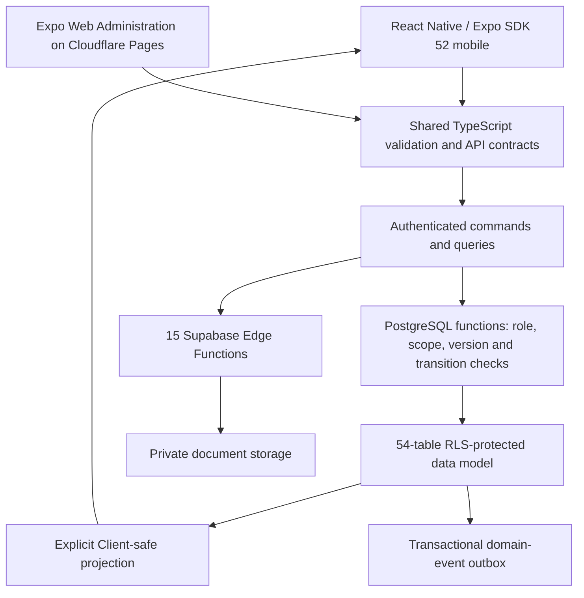
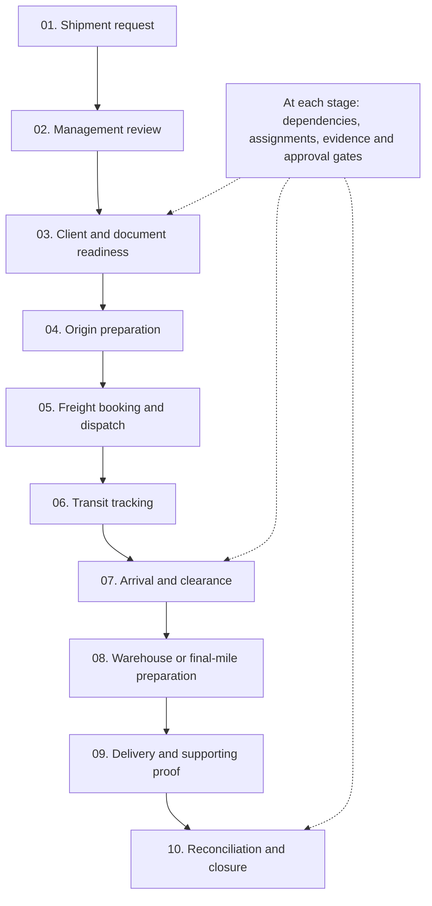
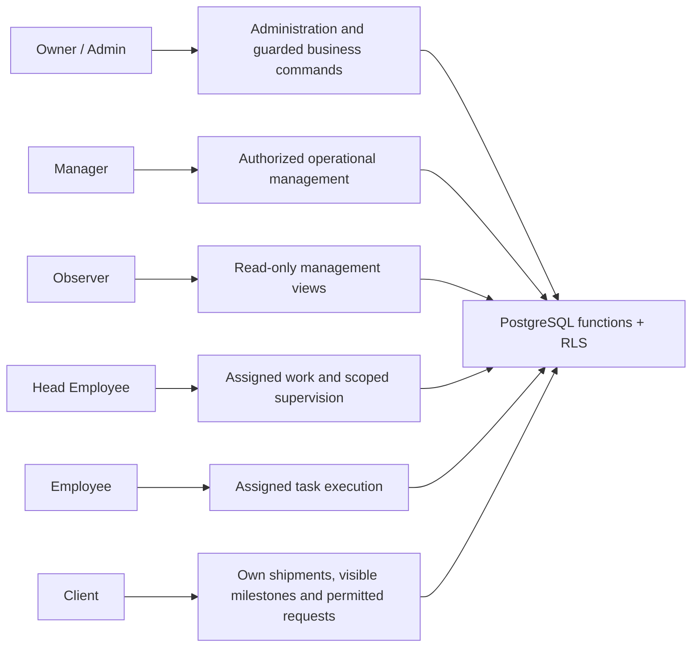
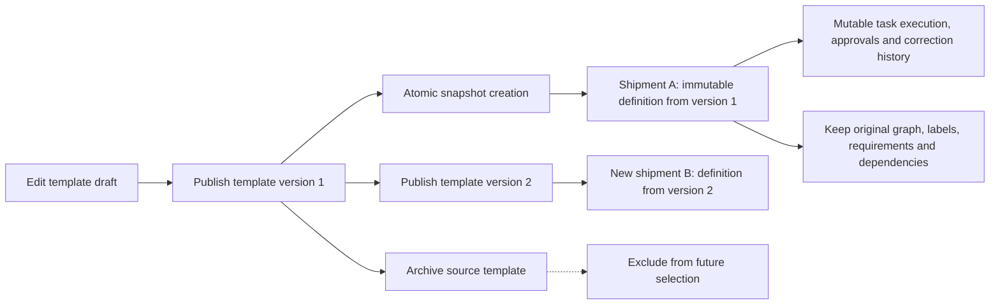

# ATG Logistics & Workflow Operations Platform

**A six-role TypeScript operations platform that turns freight workflows into versioned, permissioned and auditable execution.**

I architected and built the mobile, administrative and backend contracts around one operational model: a shipment owns its workflow definition, users act within explicit authority, and every review or correction preserves its history.

**React Native · Expo SDK 52 · Expo Router · Expo Web · TypeScript · Supabase/PostgreSQL · Cloudflare Pages**

| Engineering evidence | Result |
|---|---|
| Access boundaries | **6 roles**, enforced through PostgreSQL functions, RLS and client-safe projections |
| Database/service baseline | **54 RLS-protected tables · 30 migrations · 15 Supabase Edge Functions** |
| Backend acceptance | **508 passing assertions** in the documented backend acceptance run |
| Package/workflow baseline | **93/93 regression tests passed** |
| Product surfaces | Unified mobile app; **15+ Administration web surfaces**; Arabic RTL and English LTR |
| Workflow entry | **5-step shipment wizard**; versioned templates and immutable shipment definitions |

## 1. One monorepo, shared contracts

Mobile and Administration web use shared TypeScript domain types, validation and API contracts. Expo Router organizes the six-role mobile experience; Expo Web delivers the Administration portal through Cloudflare Pages. Authorization remains in PostgreSQL functions and database policies, not in navigation visibility.



The shared packages reduce drift between interfaces. The backend still treats every request as untrusted: it resolves the authenticated actor, verifies account/role and object relationships, checks the expected version, and applies an authorized transition.

## 2. Ten-stage freight lifecycle

The following is a normalized ten-stage freight view. Service templates select their own stage labels and dependencies; the engine stores a graph rather than hard-coding one universal shipping sequence.



A five-step wizard captures and reviews the shipment inputs before authoritative creation. Reusable templates express **Case → Stage/Milestone → Task**, including requirements, dependency locks, staff assignment and review gates. Completed work can enter a guarded correction flow without erasing earlier execution history.

## 3. Six-role access and projection isolation



| Role | Operational boundary | Mutation boundary |
|---|---|---|
| Owner/Admin | Administrative and operational oversight | Guarded account, template, workflow and business commands |
| Manager | Authorized management, shipment and workflow scope | Permitted operations, reviews and assignments; not an implicit account administrator |
| Observer | Read-only operational management | No management mutation |
| Head Employee | Assigned work plus supervised team scope | Configured supervisory/review actions and permitted task execution |
| Employee | Explicitly assigned work | Task execution and permitted evidence/request responses |
| Client | Own shipments, public milestones, own vault and addressed requests | Permitted submissions/responses; no staff workflow mutation |

**Client projection is a separate contract.** Internal drafts, staff-only document requests and internal task details are excluded at the server/database boundary. A hidden button is not the isolation mechanism. Cross-client reads and writes are checked against actor-to-object relationships; staff access additionally depends on role, assignment or supervision.

## 4. Immutable workflow snapshots

Versioned templates are reusable design-time definitions. A shipment receives a copied workflow definition pinned to its selected template version. Publishing a newer version or archiving the source template changes future selection, not in-flight operations.



| Invariant | Implementation decision |
|---|---|
| Template edits must not rewrite active shipments | Copy the selected graph into shipment-owned records |
| A definition and its execution have different lifetimes | Keep immutable definition data separate from mutable task state |
| Downstream work must respect prerequisites | Enforce dependency locks and review/completion gates |
| Concurrent commands must not silently overwrite work | Check expected versions at the authoritative command boundary |
| Rework must remain explainable | Retain execution generations, review decisions and correction history |

## 5. Private documents, payment proofs and bilingual tools

- **Document vault:** private storage with actor/object authorization and scoped download paths.
- **Multi-recipient requests:** explicit request audiences, staff/Client projection boundaries and retained response history.
- **Review and correction:** record the decision and reason; preserve previous evidence when a new attempt is submitted.
- **Client onboarding:** non-blocking operator flow with atomic account/profile operations.
- **Shipment-linked payments:** requests and supporting proofs remain associated with the correct shipment and Client throughout review and resubmission.
- **Bilingual operation:** Arabic RTL and English LTR, including workflow state and review feedback.
- **Freight utilities:** CBM calculation and HS/tariff lookup alongside operational work.

The same principle applies across documents and payments: the application records an authorized action against an identified object. A UI success message, uploaded filename or model-generated answer does not grant access or approve evidence.

## 6. Transactional notification outbox

Business commands persist domain changes and notification events transactionally. Recipient resolution, deduplication, inbox creation and push delivery are separate stages, so provider latency is not part of the business transaction.

```mermaid
sequenceDiagram
    participant Actor
    participant Command as Authorized command
    participant DB as PostgreSQL transaction
    participant Outbox as Domain-event outbox
    participant Worker as Notification worker
    participant Inbox as Recipient inbox
    participant Push as Expo / FCM transport
    Actor->>Command: Submit scoped action with version/key
    Command->>DB: Validate actor, object and state
    DB->>DB: Persist domain change
    DB->>Outbox: Persist event in same transaction
    DB-->>Command: Commit
    Command-->>Actor: Durable business result
    Worker->>Outbox: Claim pending event
    Worker->>Worker: Resolve permitted recipients and dedupe
    Worker->>Inbox: Create recipient-scoped notice
    Worker->>Push: Dispatch eligible push
    Worker->>Outbox: Record outcome / retry state
```

The durable inbox and provider delivery are different guarantees. Idempotency and dedupe keys prevent retries from multiplying notices; delivery outcomes remain observable without claiming exactly-once behavior from an external push provider.

The bilingual **Owner Content Studio** adds revision and rollback contracts. Published content uses explicit audiences and revision history so recipient visibility is deliberate, and changing a publication does not silently rewrite the evidence of an earlier version.

## 7. Verification mapped to the architecture

| Recorded result | Engineering evidence |
|---|---|
| **508 backend acceptance assertions passed** | Shipment-request draft/submission boundaries, private attachments, shipment-linked payment proof/correction, content recipients/revisions, notification deduplication and authorization denials |
| **93/93 package and workflow regression tests passed** | Shared validation/API contracts, workflow operations and regression behavior at the documented baseline |
| **54 RLS-protected tables / 30 migrations / 15 Edge Functions** | Database and service architecture baseline |

The backend acceptance exercised real Auth, PostgreSQL, private Storage and Edge endpoints. These results are recorded per suite rather than added into an invented single test total. The notification acceptance demonstrates recipient-scoped inbox and deduplication behavior; it is not a push-delivery rate metric.

## 8. Engineering tradeoffs

| Decision | Chosen design | Benefit |
|---|---|---|
| Reusable workflows | Versioned templates plus shipment-owned snapshots | Reuse without mutating active operations |
| Authorization | PostgreSQL functions, RLS and explicit projections | Role and object scope stay enforceable across clients |
| Review | First-class correction/resubmission history | Operational decisions remain auditable |
| Notifications | Transactional outbox and separate transport | Business writes do not depend on provider availability |
| UI architecture | Shared TypeScript contracts across mobile and web | Consistent validation and API expectations |
| AI boundary | Deterministic workflow and permission rules | No model decides who may approve or complete a task |

## More engineering work

[Architecture showcase](https://github.com/waelabokalam/production-systems-architecture) · [TQEN](https://tqentech.com) · [Crave It](https://craveitsyria.com) · [GitHub](https://github.com/waelabokalam)
