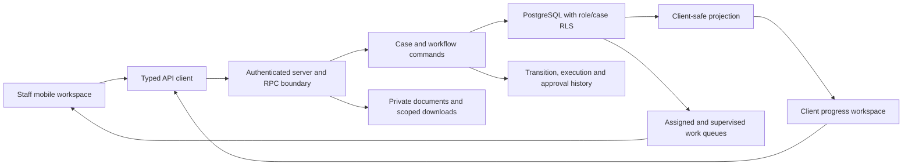
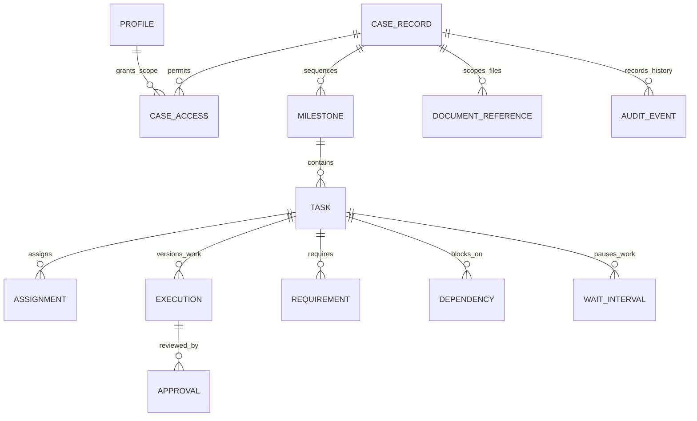
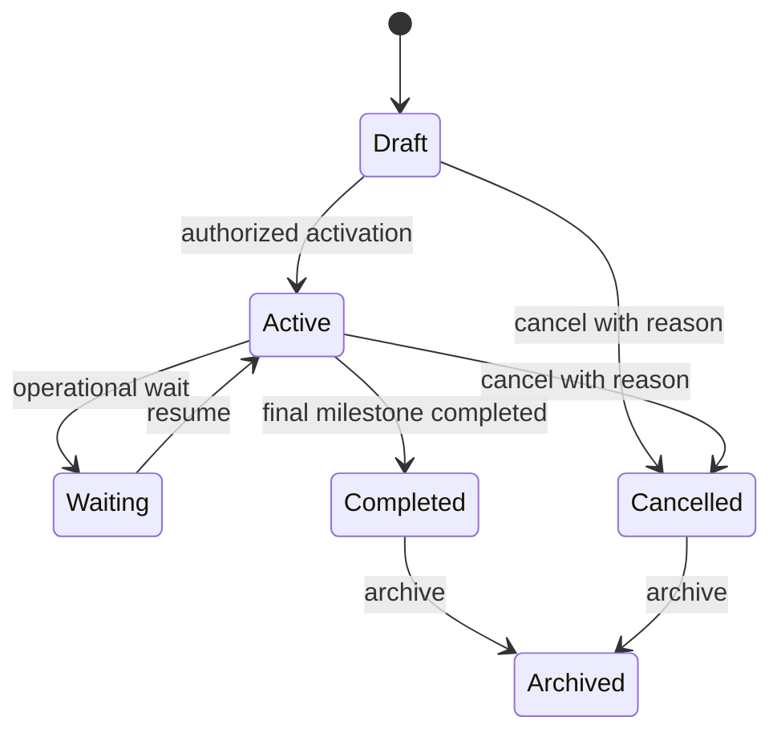
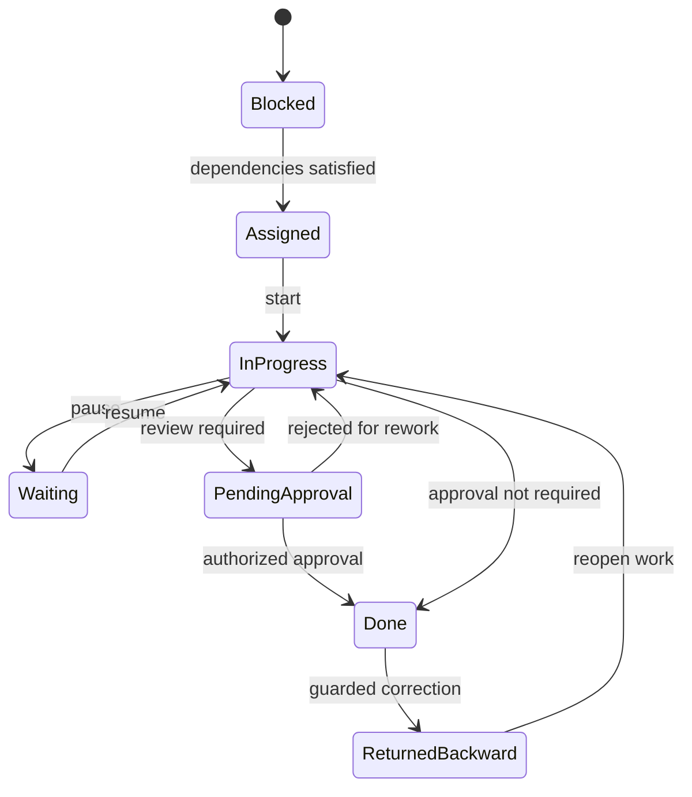

# ATG: freight operations as guarded state transitions

[Verification evidence](../evidence/verification-2026-11-01.md)

**Role:** client delivery of a mobile logistics operations platform.

**Stack:** Expo/React Native, TypeScript, Supabase/PostgreSQL, Edge Functions and private file storage.

## Delivery baseline

**54 RLS-protected tables · 30 migrations · 15 Edge Functions · 93/93 package tests** at the documented delivery milestone. The current local shared-types/API-client run passed **95 tests**. Those are package/contract checks; database and device verification have separate scopes.

## System architecture

## Schema boundaries

The 54-table baseline is grouped here by responsibility. This is a sanitized logical projection, not a commercial DDL export.

| Boundary | Access rule |
|---|---|
| Identity | Database-backed role and active-account checks; a login-screen choice does not confer authority |
| Client | Own cases and deliberately limited public progress fields; internal tasks remain internal |
| Employee | Explicit assignments and permitted case scope |
| Head employee | Supervised scope plus configured permission checks |
| Owner | Administrative operations through guarded commands, with audit history |
| Storage | Private objects and authorized access, separated from ordinary public assets |

ATG's isolation is role-, assignment- and case-scoped. TQEN's organization/branch multi-tenancy is a different model; adding a generic `tenant_id` to this diagram would obscure the actual access rules.

## Case → Milestone → Task

Each case contains ordered milestones; milestones contain tasks and dependencies. Milestone satisfaction and completion have explicit commands rather than treating every task update as a public case-status change.

### Failure modes the model addresses

- **Stale assignment or mutation:** version checks detect conflicting updates instead of silently overwriting newer work.
- **Premature completion:** task requirements, approval state and milestone dependencies gate progress.
- **Rejection after submission:** execution/rework history preserves what happened instead of erasing the previous attempt.
- **Misleading workload views:** assigned tasks and supervisory visibility are separate concepts.
- **Blocked work:** waiting intervals distinguish active work from externally blocked elapsed time.
- **Information leakage:** client-safe projections avoid exposing internal operational fields.

## Why a state machine rather than an LLM controller

| Decision | Deterministic contract | Benefit |
|---|---|---|
| Who may approve? | Authenticated role and scope | Authority remains inspectable |
| May this task finish? | State, requirements and dependency checks | Invalid transitions can be reproduced in a test |
| What did a rejection change? | Execution generation and audit history | Rework remains traceable |
| What can a client see? | Restricted projection and RLS | Public progress does not reveal the staff workflow |

## Verification and source map

The latest run passed **57 shared-types tests** and **38 API-client tests**. They cover schema contracts, workflow states, error mapping, task execution, management commands, storage adapters and client/API contracts. They do not execute every live PostgreSQL RLS policy or prove physical-device delivery.

Inspected areas: `packages/shared-types/src/workflow-enums.ts`, `workflow-entities.ts`, `packages/api-client/src/workflow-service.ts`, the package test suites, and the private role/RLS architecture and delivery-baseline records. Full migrations, permissions configuration and operational records are not distributed in this showcase.
