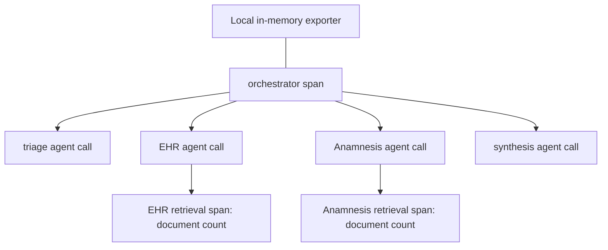

# ClinicalBridge: payload-free OpenTelemetry evaluation traces

**Academic prototype | Locally tested instrumentation | Portable public proof**

This upgrade instruments the real ClinicalBridge `process_alert` orchestrator, its agent-call boundary and both EHR/anamnesis retrieval functions. The [reviewable patch](../evidence/clinicalbridge-opentelemetry.patch) applies to public base commit `ceb134f0f2650b789c2bf6672229d3129b2f4b73`. The patch is prepared locally; publication of this case study does not imply that the original ClinicalBridge remote has been updated.

## Inspect the boundaries



- Tracing is opt-in and per-context. Disabled operation creates no exporter and does not change answers.
- The exporter stays in memory: no collector, credential, network exporter or global provider is configured.
- Closed operation names, bounded outcomes and document counts are exported. No prompts, patient identifiers, retrieved text, result payloads, exception messages or stack traces enter spans.
- Error paths record error status without exception content. Export failure leaves the workflow result unchanged.
- The underlying academic workflow's session logs are separate and unchanged; tracing does not make those logs redacted or establish clinical deployment readiness.

## Verification scope

Eight local tests exercise the real orchestrator with agent responses stubbed, and test the real EHR/anamnesis retrieval functions separately with model/vector adapters stubbed. They check parent-child relationships, hard patient retrieval filtering, disabled tracing, metadata-only exports, exception redaction, returned failures, offline export failure and closed operation names.

The portable [helper](../examples/clinicalbridge_tracing.py) and [public regression suite](../proof_tests/test_clinicalbridge_tracing.py) run with `python -m pytest -q -p no:cacheprovider proof_tests`. The original 5/5 gold scenarios and 15/15 designed failure checks remain historical project evaluation, including manual review; these new instrumentation tests are a separate count.

To reproduce the local integration proof, clone `https://github.com/waelabokalam/clinicalbridge.git`, check out the base above, apply the patch, install `requirements-observability.txt`, then run the command below. No model key or patient dataset is needed for those tests. The exporter follows the [official OpenTelemetry Python instrumentation API](https://opentelemetry.io/docs/languages/python/instrumentation/).

## Actual captured integration-test transcript

```text
$ PYTEST_DISABLE_PLUGIN_AUTOLOAD=1 python -m pytest -q -p no:cacheprovider eval/test_observability.py
........                                                                 [100%]
8 passed in 0.03s
```

## Exported tracing helper

```python
"""Opt-in, local OpenTelemetry without clinical text or process-global exporters.

SDK pattern: https://opentelemetry.io/docs/languages/python/instrumentation/
Only closed operation names, outcomes and document counts enter spans. Arguments,
results, patient identifiers, prompts and exception text never enter telemetry.
"""
from contextlib import contextmanager
from contextvars import ContextVar
from functools import wraps


_tracer = ContextVar("clinicalbridge_tracer", default=None)
OPERATIONS = frozenset({"orchestrator", "agent_attempt", "ehr_retrieval", "anamnesis_retrieval"})
OUTCOMES = frozenset({"completed", "failed", "escalated_critical"})


def trace_operation(operation):
    if operation not in OPERATIONS:
        raise ValueError("Unregistered trace operation")

    def decorate(fn):
        @wraps(fn)
        def wrapped(*args, **kwargs):
            tracer = _tracer.get()
            if tracer is None:
                return fn(*args, **kwargs)
            from opentelemetry.trace import Status, StatusCode

            # Explicitly disable automatic exception/stack capture: exception
            # messages can contain clinical text even when arguments are omitted.
            with tracer.start_as_current_span(
                "clinicalbridge." + operation,
                record_exception=False,
                set_status_on_exception=False,
            ) as span:
                try:
                    result = fn(*args, **kwargs)
                except Exception:
                    span.set_status(Status(StatusCode.ERROR))
                    raise
                outcome = result.get("status") if isinstance(result, dict) else None
                if outcome in OUTCOMES:
                    span.set_attribute("clinicalbridge.outcome", outcome)
                if operation.endswith("retrieval") and isinstance(result, list):
                    span.set_attribute("clinicalbridge.document_count", len(result))
                span.set_status(Status(StatusCode.ERROR if outcome == "failed" else StatusCode.OK))
                return result
        return wrapped
    return decorate


class LocalTracing:
    """No endpoint, credential, network exporter or global provider is configured."""
    def __init__(self, *, enabled=False, exporter=None):
        self.provider = self.tracer = self.exporter = None
        if enabled:
            from opentelemetry.sdk.resources import Resource
            from opentelemetry.sdk.trace import TracerProvider
            from opentelemetry.sdk.trace.export import SimpleSpanProcessor
            from opentelemetry.sdk.trace.export.in_memory_span_exporter import InMemorySpanExporter
            self.exporter = exporter if exporter is not None else InMemorySpanExporter()
            self.provider = TracerProvider(resource=Resource({"service.name": "clinicalbridge-local-evaluation"}))
            self.provider.add_span_processor(SimpleSpanProcessor(self.exporter))
            self.tracer = self.provider.get_tracer("clinicalbridge.evaluation")

    @contextmanager
    def activate(self):
        token = _tracer.set(self.tracer)
        try:
            yield self
        finally:
            _tracer.reset(token)

    def shutdown(self):
        if self.provider is not None:
            self.provider.shutdown()
```
