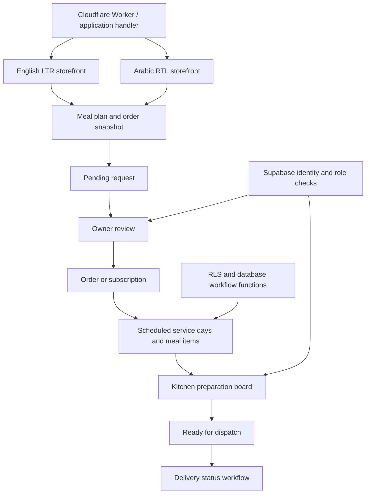

# Crave It: bilingual ordering connected to kitchen operations

[Live product](https://craveitsyria.com) · [Verification evidence](../evidence/verification-2026-11-01.md)

**Role:** independent product design, implementation and shipping.

**Stack:** React/TypeScript, Supabase/PostgreSQL and RLS, with a Cloudflare Workers deployment path through vinext/Vite.

## Product workflow

The public English/Arabic experience covers meal discovery and plan construction. Owner workflows handle requests, customers, orders, subscriptions and payments; the kitchen sees the operational preparation work it needs.

## Operational states

| Object | Explicit states or decision boundary |
|---|---|
| Plan request | Only a pending request can be approved or rejected |
| Request approval | Owner role; kitchen cannot approve commercial requests |
| Kitchen item | Scheduled → Preparing → Ready |
| Delivery | Scheduled, Ready, Out for delivery, Delivered, Failed or Skipped |
| Subscription preparation | Database RPC derives date-specific operational work |

Kitchen preparation and delivery are separate workflows. Preparing a meal does not automatically assert that the customer has received it.

## Bilingual correctness is a data contract

- English and Arabic dictionaries have matching key shapes.
- Locale-aware routes and text direction keep Arabic RTL behavior explicit.
- Missing Arabic database text has a predictable English fallback.
- Localized order messages preserve meal quantities, prices and delivery choices.
- Preferred delivery times are normalized before entering the operational workflow.

## Authorization and privacy

Server-side admin helpers authenticate the Supabase user, load an active profile, and permit the `owner` or `kitchen` role before protected operations. Owner-only commands add a narrower role gate. Database RLS and protected workflow functions reinforce these boundaries.

Kitchen access is purpose-specific: preparation state and necessary instructions are distinct from customer management, financial actions and business settings. This case study uses synthetic examples and contains no customer contacts, addresses, meal preferences or payment records.

## Tradeoffs

| Decision | Choice | Reason |
|---|---|---|
| Translation | Explicit dictionaries and localized database fields | Predictable UI parity and operational meaning |
| Commercial approval | Owner-reviewed request transition | No model decides a subscription or payment change |
| Preparation | Date-specific service records and kitchen states | A repeatable queue instead of loosely coupled status labels |
| Deployment | Worker/application boundary and server-side Supabase access | Keep infrastructure credentials outside the browser |

## Verified checks and inspected components

**11 focused checks passed** for localization, preferred delivery times, pending-only request transitions, owner-only review and snapshot preservation. They were bundled from the real TypeScript modules and run locally with Node's test runner, without a production database or build/deploy step.

Inspected areas: `lib/i18n`, `lib/plan-request-status.ts`, `lib/plan-request.ts`, `lib/admin/auth.ts`, `lib/admin/operations.ts`, `app/admin/operations-actions.ts`, `components/admin/kitchen-workspace.tsx`, the delivery/operations types, database policy migrations and `worker/index.ts`.
