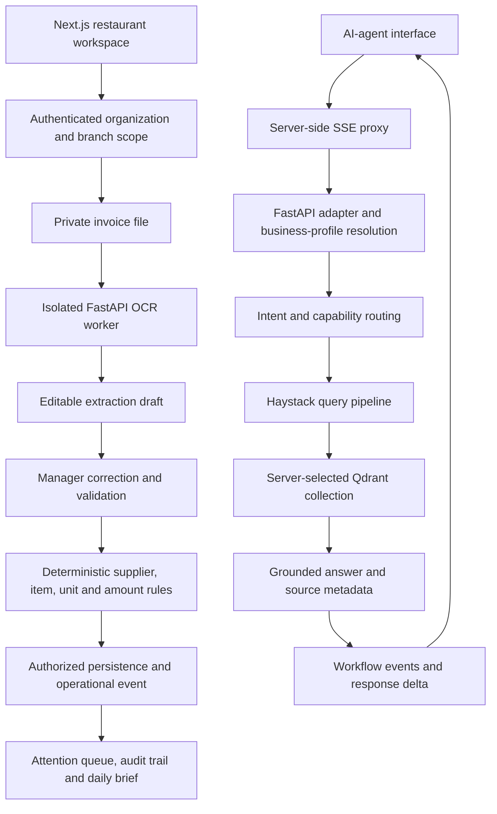

# TQEN: AI assistance with explicit operational boundaries

[Live product](https://tqentech.com) · [Verification evidence](../evidence/verification-2026-11-01.md)

**Role:** independent product design, implementation, testing and deployment.

**Stack:** Next.js/TypeScript, FastAPI, PostgreSQL/Supabase, Haystack, Qdrant, PaddleOCR and SSE.

[Invoice reliability lab and results](../labs/tqen-invoice-reliability/RESULTS.md): a replay of 40 frozen, synthetic OCR extracts, split evenly into development and holdout with no shared templates or supplier families. The assisted gate uses a known synthetic supplier catalog for both splits. On the 20 holdout cases, the baseline marked all 20 `READY`, including 12 labeled unsafe; the assisted gate marked 8 `READY` and sent 12 to review, with no wrong-ready cases in this replay.

The assisted gate checks exact supplier and item identity, compatible units, currency, a valid invoice date, positive quantity and unit price, and exact reconciliation of lines, subtotal, tax and total. A near supplier name is only a suggestion. `READY` means the checks passed; it does not approve or write an invoice. The lab does not run OCR, call providers, or measure production accuracy.

Run from the showcase repository root with Python 3.10 or newer (use `python3` if your shell has no `python` command). The evaluator has no third-party dependencies; the second command requires pytest.

```sh
python labs/tqen-invoice-reliability/run_eval.py --fixtures labs/tqen-invoice-reliability/fixtures/invoices_v1.json
python -m pytest -q labs/tqen-invoice-reliability
```

## Product problem

Restaurant teams need to turn supplier documents and fragmented operational information into reviewable work. OCR is useful for extraction; it is insufficient authority for supplier matching, invoice verification or business mutations. Conversational answers need a separate, tenant-scoped retrieval path.

## Architecture



Restaurant ingestion and conversational RAG are separate service paths. The OCR worker extracts document evidence without accessing Supabase; authenticated application services own invoice semantics and persistence. OCR documents are not implicitly indexed into the conversational knowledge base.

The SSE adapter emits observable request, retrieval and response lifecycle events. In the inspected adapter, a capability can finish before its answer is emitted as a response delta; the event contract does not imply token-by-token model generation.

## Deterministic invoice verification

| Situation | Decision | Why |
|---|---|---|
| Exact normalized supplier name | Link the existing supplier | Repeatable identity matching |
| Similar but non-exact name | Leave unmatched and request review | Similarity is evidence, not identity |
| Exact item name and compatible unit | Link the item | Unit compatibility belongs in the match contract |
| Same item name, incompatible unit | Require review | Avoid comparing unrelated quantities |
| Price/currency change or inconsistent totals | Preserve an anomaly for review | Keep operational decisions explicit |
| OCR unavailable or uncertain | Use the editable/manual extraction path | A provider failure need not become an invented invoice |

### Why rules beat a pure LLM at this boundary

| Responsibility | Chosen boundary | Tradeoff |
|---|---|---|
| Document understanding | OCR/provider adapter behind a stable extraction contract | Handles varied layouts; evidence still needs review |
| Entity identity and unit comparison | Deterministic normalization and matching | Conservative matching creates review work instead of silently linking the wrong record |
| Approval and data mutation | Authorized application service and database workflow | Less autonomous, but auditable and predictable |
| Conversational answers | Haystack/Qdrant retrieval and generation | Useful synthesis with an explicit grounding boundary |

## Security and tenancy

- Organization and branch identifiers are checked against authenticated membership on the server.
- Database RLS/RPC authorization reinforces application checks.
- Private invoice files travel through an authenticated server route to the isolated OCR worker.
- The conversational backend resolves a business profile and selects approved collections server-side; browser input does not choose arbitrary retrieval stores.
- Server credentials stay behind the proxy. Public summaries contain no provider tokens, supplier records or storage URLs.

## What the tests establish

The **108-test delivery milestone** spans the project; it is not 108 separate OCR accuracy tests. The inspected suites exercise invoice normalization/matching, unit mismatches, price/total anomalies, operational summaries, error handling, proxy contracts and stream/session behavior.

The current provider-free frontend run passed **109 tests across 10 files**, with **2 provider-dependent checks skipped**. The separate live-service test file was excluded. This verifies local rule and contract behavior without claiming a fresh OCR-model benchmark, hosted RLS test or full production certification.

## Source map used for this walkthrough

| Component | Inspected source area |
|---|---|
| Extraction contract and matching rules | `lib/restaurant/invoices.ts` |
| OCR adapter and review workflow | `lib/restaurant/paddle-invoice.ts`, `invoice-services.ts` |
| Module and event ownership | `lib/restaurant/README.md` |
| Isolated document worker | `services/invoice-ocr/README.md` |
| RAG indexing/query pipeline | Backend `src/rag_pipeline.py` |
| Scoped routing and SSE event contract | Backend `src/nexus_sse_adapter.py` |
| Regression examples | `tests/restaurant-invoices.test.ts`, `restaurant-paddle-invoice.test.ts`, `sse-and-support-stream.test.ts` |

Paths identify the inspected components; the commercial implementation is retained privately. The [public executable examples](../examples/boundary_contracts.py) use synthetic supplier/item names and a reduced contract.
